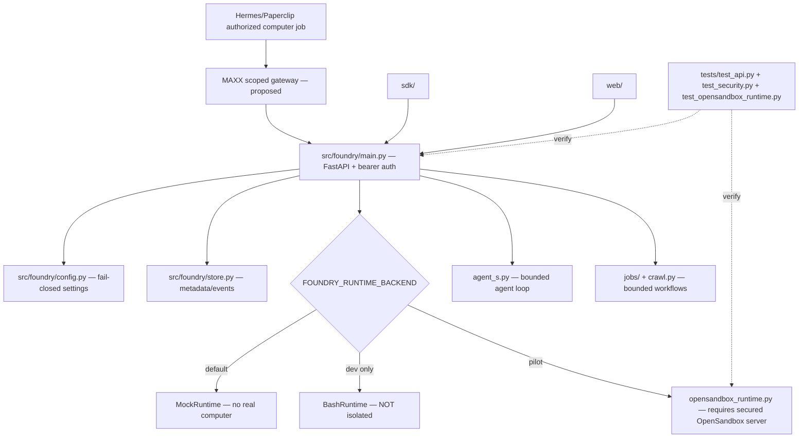

# Foundry Computer — source-grounded MAXX sandbox graph

**Status:** internal alpha architecture map, not a production sandbox attestation. Inspected 2026-11-04. This complements `AGENTS.md`'s Trail source graph, `CONTEXT.md`, `SECURITY.md` and `docs/OPENSANDBOX_PILOT.md`.

## Reality checks from source

- `src/foundry/config.py` defaults to `runtime_backend = "mock"`; production requires a non-default strong API key and a configured OpenSandbox endpoint/key.
- `src/foundry/main.py` selects MockRuntime, BashRuntime or OpenSandboxRuntime. A control-plane `/healthz` is not proof of a real sandbox.
- `SECURITY.md` explicitly states BashRuntime is not an isolation boundary and this is not a hostile public multi-tenant service.
- `docs/OPENSANDBOX_PILOT.md` requires real egress/isolation checks, draft-only job and independent review.
- `tests/` contains API, security, runtime and workflow tests. Their presence is not proof that they passed in this review.

## MAXX integration contract

Foundry is an optional computer-use worker **behind** the canonical MAXX approval/tenant gateway. It must not own business truth or raw customer credentials. Prefer Composio/API tools first. For client jobs require isolated per-client sandbox, denied host metadata access, restricted egress, real process lifecycle, logs/receipts, resource caps and verified stop/delete. Do not fall back to BashRuntime when sandbox unavailable.

**Safe next proof:** on a disposable Hostinger VPS, launch one OpenSandbox instance, prove deny-all egress and tenant isolation, run a draft-only task, verify stop/delete and resource cleanup, then revert to mock on failure.
